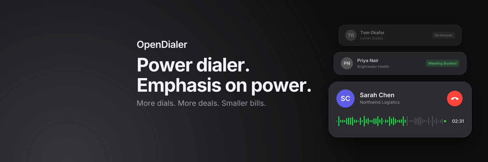

#  OpenDialer Community

OpenDialer Community is the source-available backend for teams who want to host their own dialer and bring their own carrier. **Today you can run the account module locally:** register an account, verify an email address, sign in, recover a password, and revoke a session. Campaigns and calling are the next release milestone.

[Run locally](#run-locally) · [Account API](#account-api) · [Dialer roadmap](#dialer-roadmap) · [Changelog](CHANGELOG.md) · [License](LICENSE)

## Run locally

You need Git and Docker with the Compose plugin. From a terminal, run:

```sh
git clone https://github.com/opendialer/community.git
cd community
docker compose run --build --rm test
```

Compose starts PostgreSQL 17, applies the identity schema to a fresh test database, type-checks the TypeScript package, and runs the tests. Look for a passing registration-to-logout test and a passing email-rendering test. The test calls Hono directly and captures the verification email locally. You can run it without a Resend key or a carrier account.

To remove the disposable test database when you finish:

```sh
docker compose down -v
```

## Account API

The account routes are registered by `registerAccounts(app)`. The Compose project exercises them in-process. The Docker setup runs the test suite. Serving these routes over HTTP requires a server entry point, and the frontend lives in a separate project.

| Workflow | Routes | What happens |
| --- | --- | --- |
| Register | `POST /v1/auth/register` → `POST /v1/auth/verify-email` | Request a verification email, then submit the code and choose a password. |
| Sign in | `POST /v1/auth/login` → `GET /v1/auth/me` | Exchange email and password for a bearer token, then use it to read the signed-in account. |
| Sign out | `POST /v1/auth/logout` | Revoke the current bearer session. |
| Recover an account | `POST /v1/auth/forgot-password` → `POST /v1/auth/reset-password` | Request a recovery email and use its code to set a new password. |

For a working example with requests and responses, start with the [account integration test](tests/accounts.test.ts). The [route definitions](src/identity/accounts.ts) describe the request bodies, and the [mail delivery module](src/identity/mail.ts) handles verification, recovery, and team invitation messages through Resend. Organization and invitation tables are included for that module. Team management routes are planned.

## Dialer roadmap



The first dialer milestone is a complete campaign with a simulated carrier. A team admin will be able to invite agents, import campaign numbers, and assign a queue. An agent will be able to call one number at a time, record the outcome, and schedule a callback.

The [edition roadmap](FEATURES.md) lists planned Community capabilities and the commercial features, including parallel dialing, CRM profiles, and enrichment. The [changelog](CHANGELOG.md) tracks what has shipped in this repository.

## License

The Community Internal Use License permits running the unmodified software for personal use or internal business operations. Modification, resale, redistribution, and hosting it for others require written permission. The license also covers the included OpenDialer artwork. [Read the license](LICENSE).
